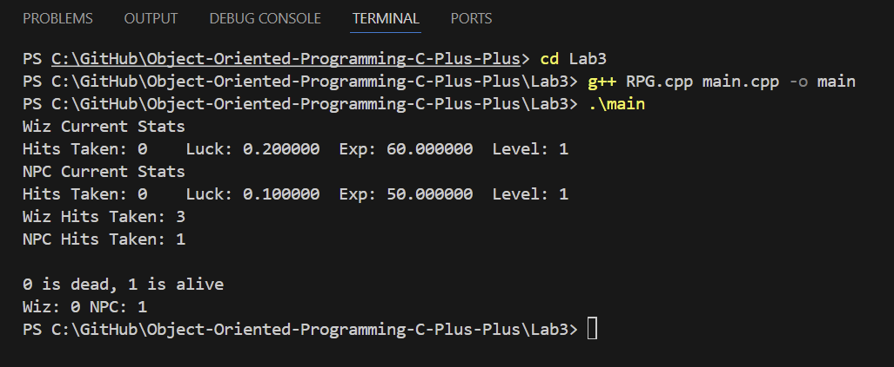
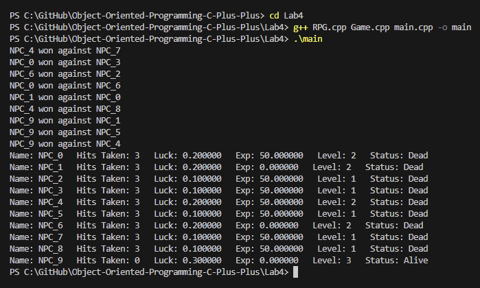
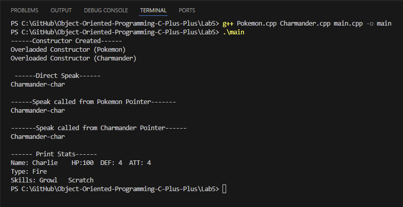

# Object-Oriented Programming in C++

C++ programs from **ECE 2310 – Object-Oriented Programming in C++** at **Cal Poly Pomona** (Fall 2025). The labs go from toolchain setup and memory-level data structures up to multi-file class design, pointer-based object management, inheritance, and polymorphism. Two of them are small turn-based simulations: an RPG battle tournament and a Pokémon class hierarchy.

---

## Skills Demonstrated

| Area | What's demonstrated |
|---|---|
| **Memory & data structures** | Static arrays vs. `std::vector`, element addresses, pointer arithmetic, how arrays decay to pointers when passed to functions |
| **Parameter passing** | Pass-by-value vs. pass-by-reference (`&`) vs. pass-by-pointer (`*`), `const` correctness |
| **Class design** | Translating UML into classes, encapsulation with `private` members, accessors/mutators, member initializer lists, constructor overloading |
| **Project structure** | Splitting code into headers (`.h`), implementation (`.cpp`), and drivers (`main.cpp`) with include guards |
| **STL** | `std::vector`, `std::set`, iterators with `std::advance` |
| **Randomness** | `<random>`: `std::mt19937`, `uniform_int_distribution`, `uniform_real_distribution` |
| **Inheritance & polymorphism** | Base/derived classes, `protected` members, `virtual` functions, overriding, base-class pointers, calling the parent implementation |

---

## Toolchain

- **Language:** C++ (C++11 or later)
- **Compiler:** g++ (GCC)
- **Editor:** Visual Studio Code
- **Version control:** Git & GitHub

---

## Projects

| Folder | Project | Key Concepts |
|---|---|---|
| [`Lab1`](Lab1) | Hello World & Environment Setup | IDE, CLI, compiling with g++, `iostream` vs. `printf` |
| [`Lab2`](Lab2) | Arrays vs. Vectors: Memory Layout | Contiguous memory, pointers, pass-by-reference, `push_back` / `pop_back` |
| [`Lab3`](Lab3) | RPG Character Class | UML to class, encapsulation, multi-file structure, constructors |
| [`Lab4`](Lab4) | RPG Battle Tournament | Pointers to objects, `std::set`, random matchmaking, game loop |
| [`Lab5`](Lab5) | Pokémon Inheritance Hierarchy | Inheritance, `virtual` functions, polymorphism through base pointers |
| [`Pet`](Pet) | Pet Class | Practice exercise on constructors, getters and setters |

---

### Lab 1 – Hello World & Environment Setup
Sets up the development workflow: IDE, GitHub repository, command-line navigation, and compiling and running C++ from the terminal. The program prints with both C++ streams (`cout`) and C-style `printf`.

### Lab 2 – Arrays vs. Vectors: Memory Layout
Two programs that print every element with its memory address, so you can see that both containers store elements contiguously.
- **`array.cpp`** passes a C-style array to functions (where it decays to a pointer) and changes it in place.
- **`vector.cpp`** passes a `std::vector` by value to print and by reference to modify, then uses `pop_back` / `push_back` to show the vector resizing.


### Lab 3 – RPG Character Class
Implements an `RPG` character class from a UML diagram. Each character has a name, hits taken, luck, experience, and level. The class has default and overloaded constructors using initializer lists, `const` accessors, and an `isAlive()` check against a maximum-hits constant. The code is split into `RPG.h`, `RPG.cpp`, and a `main.cpp` test driver.



### Lab 4 – RPG Battle Tournament
Extends the `RPG` class into a last-one-standing tournament:
- A `Game` class creates *n* players as `RPG*` objects and tracks surviving player indices in a `std::set<int>`.
- Matchups are picked at random from the survivors using `std::mt19937`.
- `attack(RPG* opponent)` changes the opponent through a pointer. The chance of a hit depends on the defender's luck.
- Winners gain experience. Every 100 XP gives a level and a luck bonus. Losers are removed until one player is left, and then every player's final stats are printed.



### Lab 5 – Pokémon Inheritance Hierarchy
A `Pokemon` base class with `protected` stats and `virtual` `speak()` / `printStats()` methods. `Charmander` inherits from it, adds a skill list, and overrides both methods. Its `printStats()` calls `Pokemon::printStats()` and then adds its own output. The driver calls `speak()` on the object directly, through a `Pokemon*`, and through a `Charmander*` to show dynamic dispatch. It also logs constructor calls so you can see the order in which base and derived objects are built.



### Pet – Class Practice
A small `Pet` class (name, age, owner, house-trained status) with constructors, accessors, and mutators, plus a driver that updates an object's state.

---

## Building & Running

Each folder is a standalone program. From inside a folder:

```bash
# Single-file labs
g++ -std=c++17 Hello.cpp -o hello && ./hello          # Lab1
g++ -std=c++17 vector.cpp -o vector && ./vector       # Lab2 (or array.cpp)

# Multi-file labs
g++ -std=c++17 *.cpp -o app && ./app                  # Lab3, Lab4, Lab5, Pet
```

---

> Coursework for ECE 2310. The lab specifications and starter outlines came from the course. The implementations are my own.
